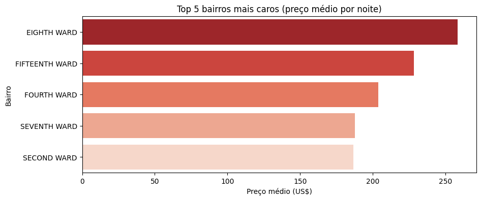
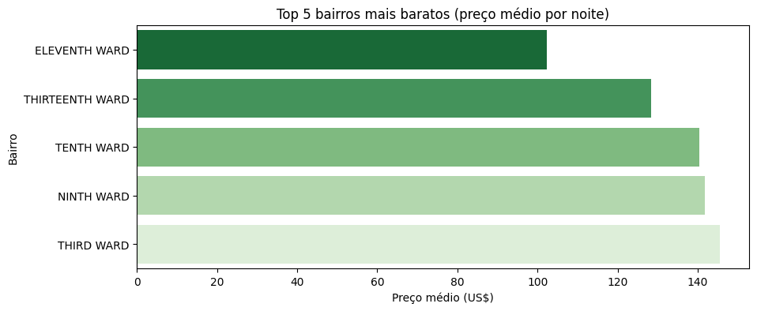
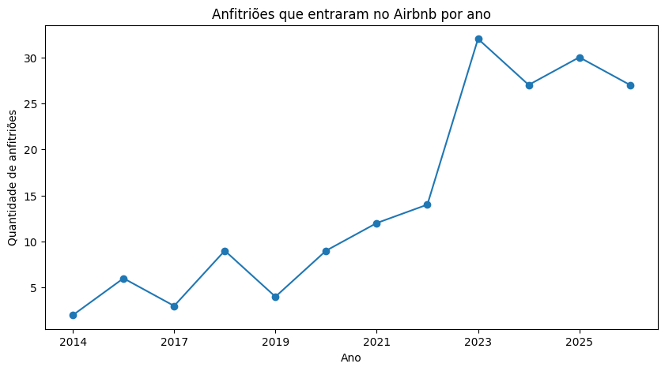

# Análise de preços do Airbnb em Albany (Nova York)

Projeto de tratamento e análise de dados com Python e pandas, desenvolvido como conclusão da formação de Python para Data Science da Alura (64 horas).

O objetivo foi pegar uma base pública real, com dados sujos, deixá-la confiável e usá-la para responder perguntas sobre os preços das hospedagens em Albany, capital do estado de Nova York. Os preços da base estão em dólar.

## Perguntas

1. Quais são os bairros mais caros e os mais baratos?
2. Quanto custa cada tipo de acomodação nos bairros com mais anúncios?
3. Superhosts cobram mais e são mais bem avaliados?
4. Quais são as comodidades mais comuns? Ter piscina deixa a diária mais cara?
5. Quantos anfitriões entraram no Airbnb a cada ano?
6. Quanto custa a diária média em reais?

## O que foi feito

### 1. Coleta e entendimento da base
- Leitura do arquivo `listings` do Inside Airbnb, carregando apenas as 29 colunas necessárias.
- Tradução dos nomes das colunas para o português.
- Verificação do tamanho da base, dos tipos de cada coluna e da quantidade de valores nulos.

### 2. Tratamento
- **Duplicadas:** verificação de linhas repetidas e do mesmo imóvel cadastrado mais de uma vez (mesmo anfitrião, nome e localização).
- **Preço:** conversão de texto (`$1,234.00`) para número, removendo o símbolo e o separador de milhar.
- **Taxas do anfitrião:** conversão de texto (`95%`) para número entre 0 e 1.
- **Colunas de sim/não:** os valores `t` e `f` foram convertidos para verdadeiro e falso com um dicionário de mapeamento.
- **Datas:** conversão das colunas de data para o tipo datetime.
- **Anúncios sem avaliação:** removidos, pois não têm notas para as análises de avaliação.
- **Banheiros:** extração do número de banheiros a partir do texto (`1.5 baths` vira `1.5`; `Half-bath` vira `0.5`) com expressões regulares.

### 3. Outliers
- Identificação dos preços fora do padrão pelo método do intervalo interquartil (IQR).
- Remoção desses anúncios, porque preços extremos distorcem a média e não representam a hospedagem típica.

### 4. Transformações
- **Comodidades:** conversão do texto para lista e uso do `explode` para contar cada comodidade separadamente.
- **Piscina:** criação de uma coluna indicando se o anúncio tem piscina, desconsiderando termos parecidos que não são piscina (mesa de sinuca, vista da piscina e a marca Whirlpool).
- **Ano de entrada:** criação de uma coluna com o ano em que o anfitrião entrou no Airbnb.

### 5. Análises
- Preço médio por bairro, considerando apenas bairros com pelo menos 10 anúncios.
- Tabela dinâmica (pivot_table) com o preço médio por tipo de acomodação nos 5 bairros com mais anúncios.
- Comparação de preço e nota entre Superhosts e demais anfitriões.
- Ranking das comodidades mais comuns e comparação de preço entre anúncios com e sem piscina.
- Quantidade de anfitriões que entraram na plataforma por ano.
- Conversão da diária média de dólar para real com a cotação obtida na API do Banco Central.

### 6. Exportação
- Base tratada salva em CSV e em um arquivo SQLite.

## Resultados

A base tinha 500 anúncios. Depois do tratamento ficaram 432 para a análise.

**1. Bairros mais caros e mais baratos.** O Eighth Ward é o bairro mais caro, com média de US$ 258 por noite. O mais barato é o Eleventh Ward (US$ 102), cerca de 2,5 vezes menos.

**2. Tipo de acomodação.** Nos 5 bairros com mais anúncios, a casa ou apartamento inteiro custa entre US$ 163 e US$ 211, e o quarto privativo entre US$ 79 e US$ 115. Em 4 desses bairros, o inteiro custa mais que o dobro do quarto.

**3. Superhosts.** Cobram mais e são mais bem avaliados: US$ 162,65 contra US$ 147,24 (cerca de 10% a mais) e nota média de 4,89 contra 4,59.

**4. Comodidades.** As mais comuns são as necessidades mais básicas: Wi-Fi (97% dos anúncios), alarme de fumaça (96%) e cozinha (89%). Anúncios com piscina custam em média 15% a mais, mas são só 5 anúncios.

**5. Novos anfitriões.** A quantidade de anfitriões vem crescendo: foram 2 em 2014, 14 em 2022 e 32 em 2023. O ano de entrada foi estimado pela primeira avaliação, porque a data de cadastro veio vazia nesta extração.

**6. Diária em reais.** A diária média é de US$ 154,83, o que equivale a R$ 825,97 (dólar a R$ 5,33).

### Limitações
- O preço analisado é o anunciado, não o valor pago pelo hóspede.
- Os dados são de uma única extração.
- Albany tem poucos anúncios, então algumas comparações (como a da piscina) têm poucos casos.

## Ferramentas

Python, pandas, NumPy, Matplotlib, Seaborn, Requests e Google Colab.

## Fonte dos dados

[Inside Airbnb](https://insideairbnb.com/get-the-data/), Albany, licença [CC BY 4.0](https://creativecommons.org/licenses/by/4.0/).
